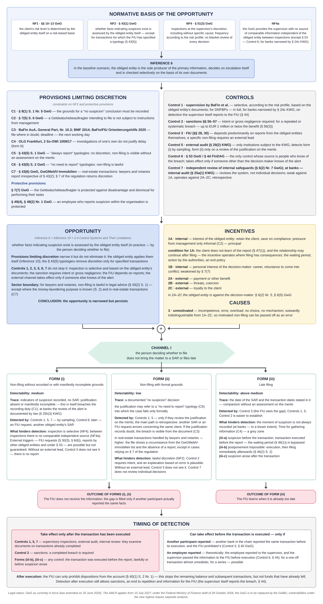

# Channel I — Failure to File a SAR or to File It in Time

**Law:** Geldwäschegesetz (GwG)  
**Jurisdiction:** Germany  
**Law version:** as of 29.06.2026  
**Method:** Law-X-Ray Corruption Vulnerability Framework v3.9  
**Level:** Channel of Realisation  

---

> **Limitation on the Subject Matter of the Research**
>
> This work does not offer a comprehensive assessment of the GwG. It does not evaluate the statute's overall effectiveness, the quality of its legislative drafting, its consistency with international standards (FATF, EU law), or any other regulatory criteria. The subject of the research is confined to a single, specific cross-section: the reconstruction of reproducible architectural conditions under which the statute's normative structure creates the possibility of corrupt influence, concealment of information, distortion of decisions, or evasion of oversight. All other aspects of the statute fall outside the scope of the analysis and receive neither a positive nor a negative assessment.
>
> Furthermore, this research does not guarantee an exhaustive reconstruction of every institutional vulnerability that may arise within the GwG normative architecture. The vulnerabilities identified are the result of the analysis performed and do not exclude the existence of other architectural vulnerabilities or institutional configurations that further research may reveal.

---

# Introduction

## What Law-X-Ray Is

Law-X-Ray is a methodology for reconstructing institutional vulnerabilities that arise from the very architecture of a normative act: from which decisions the statute leaves to the discretion of those it addresses, and from how control over those decisions is organised. The reconstruction is built solely on normative facts (provisions of the statute), logical inferences from them and recognised theories, and is then compared against available empirical data.

## What This Document Presents

The document contains the results of a pilot application of the methodology to the German Money Laundering Act (Geldwäschegesetz, GwG): one Channel of Realisation of a vulnerability, selected for initial independent expert review:

- Channel I — failure to file a SAR or to file it in time.

The Channel forms part of a broader reconstruction of the GwG. Channel II is set out in a separate document; the other results of the reconstruction are not included in this document. The document has been prepared for review by an anti-money-laundering specialist.

## Structure of the Document

**Section 1** describes the Channel itself: its diagram (1.1) and its description field by field (1.2). The full-size diagram is also available as a separate file: [`channel_01-diagram.pdf`](channel_01-diagram.pdf).

**Section 2** sets out the grounds of the reconstruction: the normative facts, the logical inferences from them, the theoretical basis and the existing control systems with their limitations.

**Section 3** contains the empirical verification.

Normative facts and inferences are numbered consecutively across the full research, so some numbers are skipped in this document.

## How the Channel Description Is Organised

A Channel of Realisation is a concrete, behaviourally describable way in which a structural opportunity created by the statute may be exploited. A Channel is defined by the action, not by its cause. The description of each Channel comprises the following fields:

- **Structural basis** — the normative facts and inferences on which the Channel rests;

- **Description and type of actor** — the action, the forms in which it manifests itself, and who carries it out;

- **Cause / incentive** — what lies behind the action: motivated causes (internal incentives 1A–1B and external incentives 2A–2C) and unmotivated causes (3 — incompetence, error, overload);

- **Rationality** — the ratio of benefit to expected costs for the participants; no quantitative calibration is performed in this document, and parameters that would require it are marked "\[not calibrated\]";

- **Detectability** — whether the action leaves a trace, and who can detect it and under what conditions; the assessments are qualitative;

- **Persistence** — whether the Channel recurs after the first instance and what ends it;

- **Operational details** — whether a more specific operational scheme exists; if so, it is deliberately not described, so that the text does not become an instruction for evading the statute;

- **Empirics** — comparison with decisions of supervisory authorities and case law, stating the access method and the date of verification; set out separately (3. Empirics).

## What the Reviewer Is Asked to Assess

For the Channel, an assessment along five lines would be particularly valuable:

- **Legal accuracy** — whether the relevant provisions of the GwG have been interpreted correctly;

- **Institutional realism** — whether the described scope for discretion actually exists in the German AML system;

- **Practical plausibility** — whether the described conduct is realistic given how compliance is organised in practice;

- **Constraints and controls** — whether the provisions, supervision and other factors that narrow this opportunity have been sufficiently taken into account;

- **Evidentiary sufficiency** — whether the material presented is sufficient for the stated conclusions, and where there are logical or evidentiary gaps.

It is also useful to distinguish between scenarios that are: legally impossible; legally possible but practically unlikely; practically realistic but not yet sufficiently confirmed; already confirmed empirically.

## Legal Status

Provisions are cited according to the GwG as currently in force (last amended on 29 June 2026). Regulation (EU) 2024/1624 (AMLR) applies from 10 July 2027. Under the Federal Ministry of Finance draft of 28 October 2026, the GwG is to be repealed as of that date and replaced by the Geldwäschebekämpfungsgesetz (GwBG). Vulnerabilities under the new regime require separate analysis.

# 1. Channel I — Failure to File a SAR or to File It in Time

## 1.1 Channel Diagram

The labels on the diagram (normative facts, constraints C1–C7, inferences, theories and Controls 1–7) are explained in 2. Grounds of the Reconstruction. Full-size diagram: [`channel_01-diagram.pdf`](channel_01-diagram.pdf).

## 1.2 Channel Description

- **Structural basis:**

> – Inference 6 (Normative Facts 1, 2, 4, 4a);
>
> – Normative Fact 2 (§ 43(1) GwG, subject to constraints C1–C7);
>
> – Inference 10;
>
> – TB3 — Rational Choice Theory.

- **Description:** In the course of customer due diligence, the person deciding whether to file (the decision-maker) notes one or more indicators of suspicion (an atypical transaction structure, inconsistency with the client's declared profile, use of higher-risk jurisdictions), but does not bring them to a formal decision to file a SAR (suspicious activity report; Verdachtsmeldung under § 43 GwG) — the matter is either never brought forward for consideration, or is closed with an internal "risk not confirmed" note. The grounds for this assessment must be recorded (§ 8(1) S. 1 Nr. 5 GwG; in force since 26 June 2017, originally Nr. 4), and failure to record them is a separate administrative offence (§ 56(1) Nr. 6 GwG). The recording duty does not prevent non-filing; it creates an additional control point. The Channel therefore takes the following forms: (i) non-filing without recorded grounds, or with defective ones, which additionally breaches § 8 and is more readily detectable; (ii) non-filing with formally recorded but substantively inadequate grounds, which is the main focus of this Channel. The justification may also refer to a typology excluded from the reporting obligation (§ 43(5) S. 2 GwG; see Normative Fact 2) into which the case falls only formally. (iii) Late filing: a SAR is filed, but later than § 43(1) GwG requires ("unverzüglich" — without undue delay). Case law limits the permissible review before filing: the money laundering reporting officer (Geldwäschebeauftragter) is entitled and obliged to gather internal information that arose within the business relationship and can be obtained and assessed within the short time available for review, but is not entitled to conduct investigations of their own, including questioning the client and assessing the credibility of the client's explanations (OLG Frankfurt a. M., decision of 10 April 2018, 2 Ss-OWi 1059/17, on § 11 GwG a.F.; see 3. Empirics). This narrows the window of form (iii) but does not close it: how long gathering internal information takes is still assessed by the obliged entity itself \[interpretation\]. The legal consequences depend on when suspicion arose relative to the transaction. Accordingly, form (iii) comprises three cases. (iii-a) Where suspicion arose before the transaction and the transaction was executed before the report was filed, only the late filing is an offence (§ 56(1) Nr. 69 GwG): the prohibition on executing a transaction before the FIU's consent or the expiry of the third working day applies only to a transaction for which a report has been filed (§ 46(1) S. 1 GwG). Filing after execution thus avoids the waiting period at the cost of late filing alone — an incentive towards form (iii) that follows from the structure of § 46(1) GwG \[inference under Rational Choice Theory\]. (iii-b) Where postponing the transaction is impossible or would hinder the prosecution of a suspected offence, the transaction may lawfully be executed, but the report must be filed without undue delay afterwards (§ 46(2) S. 2 GwG; failure to do so — § 56(1) Nr. 70 GwG). Whether postponement is impossible is assessed in the first instance by the obliged entity itself \[interpretation\]. (iii-c) Where suspicion arises only after the transaction (retrospective monitoring), the loss of the opportunity to prevent that transaction follows from the monitoring architecture rather than from the obliged entity's choice; what remains a choice is the delay between detection and filing, during which the client relationship and subsequent transactions continue without the FIU's knowledge. Unlike forms (i) and (ii), in form (iii) the FIU eventually receives the information — but only after the opportunity for preventive intervention has passed. In forms (i) and (ii), the obliged entity does not file a SAR despite indicators of suspicion. The statute provides for a sanction, but it applies only where intent or gross negligence (Leichtfertigkeit) is proven. For lawyers, notaries and comparable professions, the reporting obligation does not extend to information obtained in the course of legal advice or representation, unless they know that the client is using the advice for the purpose of money laundering or terrorist financing (§ 43(2) GwG). Non-filing in such a situation is lawful (this case is considered separately; on the exception for real-estate transactions under § 43(6) GwG, see Normative Fact 2).

- **Type of actor:** the decision-maker on filing a SAR: as a rule, the Geldwäschebeauftragter; where none has been appointed (§ 7(1), (3) GwG), the management of the obliged entity; for sole practitioners, the practitioner personally

- **Applicability:** where the decision on filing is taken by the obliged entity itself (its management or, for sole practitioners, the practitioner personally), items 1A and 1B of "Cause / incentive" coincide; the guarantee of independence under § 7(5) S. 6 GwG (C2) does not operate, since there is no one from whose instructions the decision-maker would need protection; for sole practitioners, in items 2A–2C there is also no counteraction from within the entity (§ 6(2) Nr. 5, § 6(5) GwG). In these cases the opportunity is broader than in the baseline case with an appointed Geldwäschebeauftragter. For lawyers, notaries and comparable professions, the Channel does not apply to information obtained in legal advice and representation (§ 43(2) S. 1 GwG), except where the person knows that the advice is being used for the purpose of money laundering or terrorist financing (§ 43(2) S. 2 GwG), and in the cases specified for real-estate transactions by the regulation under § 43(6) GwG (see Normative Fact 2).

- **Cause / incentive:** a distinction is drawn between motivated causes (incentives) — internal and external — and unmotivated causes.

> **1. Internal incentives** — created by the obliged entity itself; the obliged entity gains or does not object.
>
> **1A. Interest of the obliged entity** — to retain a valuable client and save on compliance costs; this also includes pressure from the obliged entity's management on the decision-maker. Since a Geldwäschebeauftragter who intends to file a report is not subject to instructions from management (§ 7(5) S. 6 GwG; C2), such pressure can only be informal or directed at the assessment itself of whether facts indicating suspicion exist. The principal incentive of the Channel. Filing a report is not in itself disclosed to the client (§ 47(1) GwG; Normative Fact 3), and the decision whether to continue the relationship after filing is taken by the obliged entity itself (BaFin AuA, General Part, Nr. 10.10). The interest in retaining the client therefore does not always lead to non-filing, but only where a report has tangible consequences for the transaction or the relationship: the waiting period under § 46(1) GwG, subsequent action by the authorities, an internal exit policy, and an upgrade of the client's risk class with the related enhanced due diligence obligations (BaFin AuA, General Part, Nr. 10.11; on the link with Channel II, see "Persistence" in the report on Channel II). Beneficiaries: the obliged entity and the client. Liability is administrative: for the decision-maker — where acting as a representative or under an express assignment (§ 9 OWiG; see "Allocation of liability"), and for the obliged entity (§§ 30, 130 OWiG). Favourable to the obliged entity \[not calibrated\], but not to the decision-maker personally, and therefore realised mainly under organisational pressure. Detected through supervisory inspection on the basis of the obliged entity's documents, and through Control 6 (§ 53 GwG) where someone other than the decision-maker knows of the pressure.
>
> **1B. Personal interest of the decision-maker** — career, reluctance to come into conflict with the business line. This incentive is weakened by the fact that the Geldwäschebeauftragter and their deputy must not be disadvantaged for performing their tasks, and may be dismissed only on grounds that would justify termination without notice (§ 7(7) GwG). Informal career costs nevertheless remain. Beneficiaries: the decision-maker and the obliged entity. Liability — as in item 1A. The benefit is non-material \[not calibrated\]. Detected in the same way as in item 1A.
>
> **2. External incentives** — originate from the client or a third party; the obliged entity is opposed, and its own controls work against the decision-maker.
>
> **2A. Payment or other benefit**. Beneficiaries: the decision-maker and the client; the obliged entity gains nothing. Working against the decision-maker receiving the payment are the reliability screening of employees (§ 6(2) Nr. 5 GwG) and the internal channel for reporting breaches (§ 6(5) GwG). A criminal-law layer is added — § 261, § 266 StGB where the elements of the offence are satisfied; the applicability of § 299 StGB is doubtful; §§ 331–334 StGB do not apply, except for notaries. Rational for the recipient only where the payment exceeds their expected losses on detection \[not calibrated\]. An additional path to detection is the payment trail through other obliged entities; however, the non-escalation, the payment and the link between them all have to be proven. Persistence is higher: the scope for avoiding liability through voluntary disclosure is narrow (§ 261(8) StGB; see § 43(4) GwG). No confirmed German cases were found.
>
> **2B. Threats or coercion** by the client or a third party. The decision-maker gains nothing but avoids harm. Criminal liability is borne by the person making the threat (§ 240 StGB). For the decision-maker, the pressure may be taken into account in assessing culpability. The "benefit versus sanction" calculation does not apply \[not calibrated\]. Leaves almost no trace unless the decision-maker reports it.
>
> **2C. Loyalty to the client** — personal ties with the client (kinship, friendship) or professional attachment built up over years of working with the client. The decision-maker obtains no benefit; the beneficiary is the client. As a rule there is no criminal-law layer; what remains is a breach of the GwG and of internal conflict-of-interest rules. Leaves almost no trace: there is neither a payment nor any contact distinct from ordinary work with the client \[not calibrated\].
>
> **3. Unmotivated causes**
>
> **3. Incompetence, error, overload.** There is no choice, and therefore no corruption mechanism, although the action and the outcome are the same. Only gross negligence is punishable. A systemic shortage of resources is considered separately. Outwardly these causes are indistinguishable from items 1A–2C, so motivated non-filing can be passed off as an error (see "Detectability").
>
> The type of cause changes neither the opportunity, nor the action, nor the legal characterisation of non-filing (§ 56(1) Nr. 69 GwG); it changes the beneficiary, the position of the obliged entity, additional liability, the paths to detection and persistence.

- **Rationality:** a low subjective estimate of the probability of inspection, and an expected value of the client relationship exceeding the expected sanction and reputational costs, make this Channel more attractive. Both factors affect the Channel's attractiveness but are not conditions of its occurrence: the decision may also be taken under a mistaken risk estimate or under pressure. The nominal legal risk of this Channel is high: for a serious, repeated or systematic breach the fine reaches EUR 1 million or twice the economic benefit obtained, and higher limits apply to legal persons in the financial sector (§ 56(3) GwG), so the recurrence of the Channel raises the nominal sanction. The expected sanction, however, is low owing to the low probability of detection and proof (see item 1A). Non-filing entails administrative liability (§ 56(1) Nr. 69 GwG) and, in form (i), additionally liability for failure to record the grounds (§ 56(1) Nr. 6 GwG). A personal criminal risk arises only where the conduct itself satisfies the elements of money laundering — with intent under § 261(1), (2) StGB (for obliged persons, the aggravated offence under § 261(4) StGB), or with gross negligence as to the criminal origin of the asset under § 261(6) StGB. Non-filing of a SAR does not by itself give rise to such liability. Whether this Channel is in fact used less often than others has not been measured. In form (iii), detectability reduces the Channel's attractiveness: the assessment of a matter with regard to the reporting obligation must be recorded with its grounds (§ 8(1) S. 1 Nr. 5 GwG), and the report is time-stamped on filing, so the discrepancy can be established without access to the client. Late filing may also arise without any choice to delay — where resources for reviewing alerts are insufficient. The statute does not distinguish between these causes — both fall under § 56(1) Nr. 69 GwG. BaFin's interpretive guidance requires a report to be filed no later than the working day after the prerequisites have been established (AuA, General Part, November 2024, as cited by the FIU), and, where there is doubt whether the prerequisites are met, a report must be filed (AuA, General Part, Nr. 10.3, as stated by BaFin in its announcement of 29 November 2024). Form (iii) therefore departs from a concrete benchmark, and form (ii) departs from it wherever the recorded grounds themselves document doubt. Beneficiaries: the obliged entity retains the client and, in form (iii), avoids the waiting period on the transaction; the decision-maker avoids conflict with the business line and the client; the client's transaction proceeds without a report, or before one. Qualitative conclusion: favourable to the obliged entity, unfavourable to the decision-maker personally. No quantitative calibration was performed \[not calibrated\]. In form (iii), the structure of § 46(1) GwG gives the obliged entity an incentive to file the report after the transaction has been executed (case iii-a); for the decision-maker, however, this choice is unfavourable: the report is time-stamped and the delay is visible. At credit institutions, the alert is generated by the system, and its review and outcome must be documented (§ 25h(2), (3) KWG). Non-filing without a formalised decision therefore leaves a clear trace, and the rational choice shifts towards form (ii) — closing the alert with a "no suspicion" justification.

- **Detectability:** differs by form; the assessments are qualitative (see Introduction, "How the Channel Description Is Organised"). The following covers cases where indicators of suspicion have been recorded somewhere (a monitoring alert, client records); where they have not been recorded at all, the case is considered separately. Since no SAR is filed in forms (i) and (ii), the tipping-off prohibition plays no role in the detectability of these forms. A deliberate decision not to escalate may be outwardly indistinguishable from an error (see "Cause / incentive", item 3). Since the sanction requires intent or gross negligence, this makes form (ii) even harder to prove. Where an employee passed on the alert, one more person knows of it, and that person is protected against employment-related consequences (§ 49(4) GwG) and against liability for the internal report (§ 48(2) Nr. 1 GwG). This raises the detectability of forms (i) and (ii) only slightly: the employee does not necessarily know whether a report has been filed, and can report the breach to the supervisor only through Control 6.

> **Form (i) — medium detectability.** Under the methodology's criteria: a documentary trail exists (the gap is visible), detection requires access to internal records, and the action goes beyond lawful discretion. Trace: recorded indicators of suspicion with no SAR and with no, or a manifestly incomplete, recorded justification of the decision. The gap is objective and visible without an assessment on the merits, and the absence or incompleteness of the justification is a separate breach (§ 8(1) S. 1 Nr. 5 GwG; C1). At credit institutions, the review of the alert and its outcome are documented by law (§ 25h(3) KWG). Who can detect it: Controls 1, 5 and 7 — if the case falls within the inspection sample; Control 6 — if someone other than the decision-maker knows of the alert. Records are retained for five years and destroyed no later than after ten (§ 8(4) GwG), so the case may also surface later — through an FIU request (§ 30(3) GwG) or after another obliged entity's SAR on the same client. What hinders detection: inspection is sample-based (Normative Fact 4), and between inspections there is no comparable independent source (Normative Fact 4a). External triggers — FIU requests (§ 30(3), § 6(6) GwG), reports by other obliged entities and reports under § 53 GwG — are possible but not guaranteed. Without an external lead, Control 3 does not see this, since there is no report. Control 5 applies only to institutions subject to § 29(2) KWG.
>
> **Form (ii) — low detectability.** Under the methodology's criteria: a trace exists but looks like a proper decision; detection requires access to internal records and a review on the merits; the action outwardly falls within lawful discretion. Trace: a recorded "no suspicion" decision with a justification that, to the inspector, looks like a properly documented decision. Who can detect it: Controls 1 and 5 — only on reviewing the justification on the merits, not on checking that it exists. The main path to detection is retrospective: another SAR or an FIU request concerning the same client arrives, and the justification turns out to be implausible. An additional lead is C3: if the justification itself records doubt, a report should have been filed under BaFin's guidance, and the breach is visible from the document. In real-estate transactions handled by lawyers and notaries, detectability is higher: the file shows a circumstance from the GwGMeldV-Immobilien list and the absence of a report, except in cases relying on § 7 of the regulation. What hinders detection: the assessment of indicators is lawful discretion (Normative Fact 2), and a plausible justification is hard to distinguish from a false one. Control 2 requires proof of intent or gross negligence, and an explanation based on error is most plausible here (see "Cause / incentive", item 3). Without an external lead, Control 3 does not see this, since there is no report. Control 7 reviews procedures, not individual justifications.
>
> **Form (iii) — above-medium detectability.** Under the methodology's criteria: a trace exists (dates); no access to internal records is needed — the FIU sees the gap; the action goes beyond discretion, except in the grey zone of C4. Trace: the SAR has been filed and is dated, and the report itself states the transaction dates; the comparison requires no assessment of the soundness of the decision. Who can detect it: Control 3 — the FIU receives the report and sees the time gap; Controls 1 and 5 — when checking deadlines; Control 2 is easier to establish than for forms (i) and (ii) (see 3. Empirics: the fine imposed personally on the Geldwäschebeauftragter in the OLG Frankfurt a. M. case concerned precisely this form). What hinders detection: the moment at which suspicion arose is often not recorded precisely (at credit institutions, to a lesser extent: the alert is generated by the system and its review is documented, § 25h(2), (3) KWG), so the delay is hard to measure. The requirement of acting without undue delay allows time for gathering internal information (C4), and a delay of several days or weeks falls into a grey zone.
>
> **Common to all forms.** Controls 1, 2, 5 and 7 operate on transactions already completed and therefore take effect only after a specific transaction has been executed. In cases (iii-b) and (iii-c), any control takes effect after execution. Before execution, a control can take effect in only two cases: where another participant in the chain reported the same transaction before its execution and the FIU prohibited it (Control 3, § 40 GwG), or — theoretically — where an employee reported to the supervisor and the supervisor passed the information to the FIU before execution (Control 6, § 44 GwG). After execution, the FIU can only prohibit dispositions from the account (§ 40(1) S. 2 Nr. 1 GwG): this stops the remaining balance and subsequent transactions, but not funds that have already left. The timing of detection matters: detection before the transaction is completed may prevent the transition; where the transaction has been completed and the gap has already arisen, later detection does not undo the outcome for that transaction, although it may end further exploitation of the vulnerability, trigger sanctions and have a deterrent effect. Where another obliged entity in the same chain independently identifies and reports the same circumstances, this may partly or fully close the information gap at the FIU. Three outcomes must be distinguished here: the FIU receives information on the client's suspicious activity; the FIU receives information on precisely those circumstances that the first entity did not report; the FIU learns that the first entity failed to file. The first does not guarantee the second, nor the second the third. The mere presence of another obliged entity does not guarantee that such a report will be filed. Where the supervisory authority detects the non-filing, it reports the circumstances to the FIU itself (§ 44 GwG). This closes the gap but, subject to the exception above, only after the transaction has been executed.

- **Persistence:** Channel I requires a separate active decision on each alert and therefore does not recur automatically, unlike Channel II (see the report on Channel II), where the decision is built into the methodology (TB4). Two factors may make it recurrent.

> First, once the decision-maker has failed to file a SAR on a client, they may have an incentive not to reveal the omission at the next alert \[inference under Rational Choice Theory\]. This incentive is weakened by three circumstances:
>
> – late filing constitutes the same offence as non-filing (§ 56(1) Nr. 69 GwG);
>
> – each new omission increases the risk of the breach being characterised as systematic (§ 56(3) GwG);
>
> – a new report does not necessarily reveal the earlier omission.
>
> Second, in form (iii), where suspicion arose after the transaction, the delay persists for as long as the business relationship continues.
>
> The Channel ends upon detection (including with subsequent supervisory orders under § 6(8) GwG, § 25h(5) KWG) or upon termination of the client relationship. A change of decision-maker ends the repetition of a specific person's decisions, but not the mechanism, where the incentive is organisational (item 1A).

- **Operational details:** a more specific operational scheme exists — the precise wording used to close off a decision not to escalate, and the way the internal "risk not confirmed" note is drafted so as to withstand inspection — it is not described here: a detailed account would in effect be a ready-made instruction for evading the obligation to file a SAR.
# 2. Grounds of the Reconstruction

## 2.1 Normative Facts

- **Normative Fact 1** — §§ 10–13 GwG: the obliged entity conducts customer due diligence itself and itself determines the risk level of the client relationship on the basis of a risk-based approach. The initial risk assessment is placed on the obliged entity.

- **Normative Fact 2** — § 43(1) GwG obliges the obliged entity to report once facts indicating suspicion exist; the entity's discretion lies in determining whether such facts exist, not in whether to report once they do. Official interpretive guidance narrows but does not eliminate this discretion (BMF-Auslegungshinweise, 6 November 2014; BaFin/FIU Orientierungshilfe, 28 November 2025). The grounds for concluding that no such facts exist must be recorded (§ 8(1) S. 1 Nr. 5 GwG). The Geldwäschebeauftragter is not subject to instructions from management when intending to file a report under § 43(1) GwG or when responding to an FIU request (§ 7(5) S. 6 GwG). This protection is tied to the intention to file a report and applies only where the Geldwäschebeauftragter has been appointed by law or by order (§ 7(1), (3) GwG). In addition, the FIU, in agreement with the supervisory authorities, may specify typified transactions that must always be reported, and transactions to which the reporting obligation does not apply (§ 43(5) S. 1 and 2 GwG). For the former there is no discretion, and non-filing becomes a breach visible without an assessment on the merits; for the latter, non-filing is lawful. Typologies do not remove the problem of discretion. As far as could be established, no general "always report" typologies have been specified for the financial sector. Negative typologies (FIU Eckpunktepapier, agreed with BaFin) apply only "as a rule": where additional information indicates suspicion, a report must be filed, so the question again comes down to the entity's own assessment. At the same time, a reference to a typology gives non-filing a formally lawful justification that is harder to rebut than the absence of any justification. For lawyers and notaries in real-estate transactions, the regulation issued under § 43(6) GwG (GwGMeldV-Immobilien) specifies circumstances that must be reported irrespective of § 43(2) S. 1 GwG. § 7 of the regulation removes this obligation where the available facts dispel the suspicion, and thereby returns the assessment to the entity itself. These provisions are addressed to the obliged entity itself; they narrow but do not eliminate its discretion (see Inference 10). Reference labels: C1 — § 8(1) S. 1 Nr. 5 GwG; C2 — § 7(5) S. 6 GwG; C3 — interpretive guidance (BMF-Auslegungshinweise 2014; BaFin/FIU Orientierungshilfe 2025; BaFin AuA, General Part, Nr. 10.3); C4 — judicial interpretation of the requirement to act without undue delay (OLG Frankfurt a. M., 2 Ss-OWi 1059/17; see 1.2 Channel Description, form (iii)); C5 — typologies that must always be reported (§ 43(5) S. 1 GwG); C6 — typologies to which the reporting obligation does not apply (§ 43(5) S. 2 GwG); C7 — circumstances in real-estate transactions that lawyers and notaries are required to report (§ 43(6) GwG, GwGMeldV-Immobilien, including § 7 of the regulation).

- **Normative Fact 3** — § 47 GwG (tipping-off): the obliged entity is prohibited from disclosing the fact that a SAR has been filed to the client, to the party ordering the transaction, or to third parties (§ 47(1) GwG). The prohibition does not extend to the exchange of information among obliged entities themselves: § 47(2) Nr. 2 GwG expressly permits exchange within a single corporate group (only for obliged entities under § 2(1) Nr. 1–3 and 6–8 GwG); § 47(2) Nr. 3 GwG separately permits exchange between a parent company and its branches and group entities in third countries, conditional on those entities having implemented the group-wide measures under § 9(1) GwG. § 47(5) GwG permits obliged entities under § 2(1) Nr. 1–9 GwG to exchange information about suspicious circumstances where another entity needs it to assess the risk of a similar transaction or to decide whether to file a SAR.

- **Normative Fact 4** — §§ 50–52 GwG: supervisory authorities conduct inspections of obliged entities at their discretion, including without specific cause. The frequency and intensity of inspections are determined by the obliged entity's risk profile (§ 51(3) GwG; for institutions subject to the KWG, inspections without specific cause are provided for by § 44(1) S. 2 KWG). The statute does not provide for blanket review of every decision of the obliged entity. The supervisor obtains information on the obliged entity's risks partly from the entity itself: for institutions subject to the KWG — in the auditor's reporting form, where risk factors are stated on the basis of the institution's own risk analysis (§ 27(8) PrüfbV); for entities supervised by professional chambers — through questionnaires that obliged entities must complete under § 52(1) GwG. External sources are also taken into account — the results of previous inspections and reports under § 53 GwG.

- **Normative Fact 4a** — the GwG does not provide the supervisory authority, in the intervals between inspections, with a source of comparable client-risk information independent of the obliged entity. A narrow independent channel exists for credit institutions via the account-retrieval procedure under § 24c KWG (Kontenabrufverfahren): BaFin and the Bundeszentralamt für Steuern (Federal Central Tax Office) may retrieve account master data (account number, holder's name and date of birth) directly from all German credit institutions, independent of what the obliged entity itself discloses. This channel does not cover account balances, transactions or risk classification, and is used by BaFin/BZSt principally on a case-by-case basis (e.g., a suspected offence) rather than for routine ongoing AML monitoring between inspections. No equivalent channel is available for the DNFBP sector — lawyers and notaries are not entitled parties under § 24c(3) KWG. The claim in this Normative Fact accordingly retains full force for the DNFBP sector, and is narrowed, but not eliminated, for credit institutions. In addition, any person, including an employee of the obliged entity, may report a potential or actual breach of the GwG directly to the supervisory authority (§ 53 GwG; Control 6). This source does not depend on the obliged entity's documentation, but whether it arises depends on the initiative of third parties, and it does not provide comparable client-risk information. It therefore narrows, but does not eliminate, the claim in this Normative Fact. Note on method: this is a negative normative fact — it is established from the text of the statute through the absence of a corresponding provision, not from a specific provision.

**General Caveats**

- Interpretive texts used in this reconstruction are limited to those whose existence follows from the design of the legal framework: BaFin's interpretive guidance issued under § 51(8) GwG; the EBA ML/TF Risk Factors Guidelines issued under Articles 17 and 18(4) of Directive (EU) 2015/849; the FIU's guidance on the GwGMeldV — a regulation issued under § 45(5) GwG — published within the FIU's statutory task of exchange with obliged entities (§ 28(1) GwG); and the FIU typologies specified under § 43(5) GwG. Supervisory decisions, fines and case law are not used as a basis for any conclusion in the reconstruction; they appear only in the empirical verification.

- Legal status: provisions are cited according to the GwG as currently in force (last amended on 29 June 2026). Regulation (EU) 2024/1624 (AMLR) applies from 10 July 2027. Under the Federal Ministry of Finance draft of 28 October 2026, the GwG is to be repealed as of that date and replaced by the Geldwäschebekämpfungsgesetz (GwBG). Vulnerabilities under the new regime require separate analysis.

## 2.2 Logical Inferences from the Normative Facts

- **Inference 1.** From Normative Facts 1+2 it follows \[deduction from the norm\]: primary AML information is produced and interpreted by the obliged entity — the FIU and the supervisory authorities are structurally dependent on the obliged entity's primary information. (A fuller basis for this claim is established below, together with Normative Fact 4a.)

- **Inference 2.** From Normative Fact 3 it follows \[deduction from the norm\]: the prohibition on disclosing that a SAR has been filed structurally isolates the client from knowledge of the escalation. At the same time, the statute does not prohibit — and in fact expressly permits — the exchange of information about suspicious circumstances among obliged entities themselves (§ 47(2), (5) GwG). This is a permission ("dürfen"), not an obligation, and it does not create an institutional mechanism guaranteeing that such exchange actually occurs. The isolation of information among entities is therefore not structurally prohibited by the statute, but nor is it structurally guaranteed by it — it depends on whether obliged entities make use of the opportunity provided, which goes beyond deduction from the norm.

- **Inference 3.** From Normative Fact 4 it follows \[deduction from the norm\]: external verification of the entity's decisions is periodic and selective, not continuous.

- **Inference 4a.** From Normative Facts 1+2+4+4a it follows \[institutional consequence\]: the entity exercises discretionary judgment while holding an informational advantage over the supervisory authority.

- **Inference 6 (combined).** In the baseline scenario (disregarding the countervailing incentive described in the "Caveat on the internal conflict of interest", **TB1**) — a structural asymmetry arises:

  — the obliged entity is the sole producer of the primary information, takes discretionary decisions on its escalation, and is subject to verification only selectively and on the basis of the very information it produced itself (combined: Normative Facts 1, 2, 4, 4a).

- **Inference 10.** From Normative Fact 2 (with the constraints under § 7(5) S. 6 and § 8(1) S. 1 Nr. 5 GwG and in interpretive guidance) and Normative Facts 4, 4a it follows \[institutional consequence\]: the provisions narrowing the obliged entity's discretion in assessing suspicion (C1–C7) are addressed to the obliged entity itself and are applied by it. They determine which decision is permissible, but do not ensure independent verification that precisely such a decision has been taken: compliance with them is verified only through the control systems (2.4 Control Systems and Their Limitations), which are subject to the limitations described there. Such provisions therefore narrow the opportunity described in Inference 6, but do not eliminate it (basis of the "Structural basis" field of Channel I).

## 2.3 Theoretical Basis

- **TB1 — Principal-Agent Theory** → explains the conflict of interest between the obliged entity (agent) and the state/FIU (principal): the agent holds an informational advantage and a commercial incentive to use it in its own interest rather than the principal's. Applied to the internal structure of the obliged entity, the same construction applies to employees: their individual incentives may diverge from the obliged entity's duties in both directions (see the Caveat below).

> **Caveat on the internal conflict of interest.** The reconstruction treats the obliged entity as a single actor. In reality, the compliance function within the organisation is performed by a specific natural person (§ 7 GwG — Geldwäschebeauftragter; see also § 4(3) GwG on responsibility at senior-management level), who bears personal administrative and, in some cases, criminal liability. This creates a potential countervailing incentive — to overstate rather than understate the risk classification — which runs counter to the incentive of the obliged entity as a legal person. The combined effect of these two opposing incentives has not been assessed in this analysis and requires separate consideration. Individual incentives within the obliged entity, however, run in both directions (TB1, applied to the internal structure of the obliged entity). Personal liability creates an incentive for the Geldwäschebeauftragter to overstate risk; remuneration of employees that depends on client business creates an incentive to understate risk and to withhold information. Which of these prevails depends on the organisational configuration and is not assessed in this reconstruction. The principal incentive of the Channel operates at the level of the obliged entity's escalation policy. External incentives are considered under "Cause / incentive" of the Channel, item 2. Where the countervailing incentive partly restrains realisation of the Channel in individual cases, it functions as a downward-adjusting factor rather than a refutation of the reconstruction. However, since individual incentives may also reinforce the vulnerability, the Incentive assessed here cannot be read without qualification as a conservative (lower-bound) estimate. Apart from the commercial incentive, there is an incentive of a different kind: where an FIU request under § 30(3) GwG reaches an entity that has filed no SAR, a complete response may reveal the entity's own breach of § 43 GwG. This incentive toward a minimal response is constrained by § 56(1) Nr. 67 GwG and by the independence of the Geldwäschebeauftragter when responding (§ 7(5) GwG). Moreover, responding to an FIU request exempts the entity from liability for the response itself (§ 48(2) Nr. 2 GwG), but not for the earlier non-filing.
>
> Allocation of liability. The offences in § 56 GwG are addressed to the obliged entity. An individual is liable for them where acting as a representative body of the obliged entity, or where expressly instructed to perform, on their own responsibility, duties incumbent on the obliged entity (§ 9(1), (2) OWiG). Any person who participates in an offence is liable as a participant even where the special personal characteristic — being the obliged entity — is present only in another participant (§ 14(1) OWiG). The obliged entity itself may be fined where a person in a leading position commits an offence that violates the obliged entity's duties (§ 30(1) OWiG), and the owner is liable for omitting supervisory measures required to prevent such violations, where proper supervision would have prevented or substantially impeded them (§ 130(1) OWiG). This allocation applies in particular to Channels I and V, including where the incentive is external (item 2A).

- **TB2 — Information Asymmetry Theory** → explains the dependence of the FIU and the supervisory authorities on the information the entity produces.

- **TB3 — Rational Choice Theory** → explains the choice between performing a duty and breaching it by the ratio of expected benefit to expected costs. It underlies the "Rationality" field of the Channel and the inferences marked \[inference under Rational Choice Theory\].

- **TB4 — Agency Cost Theory** (Jensen & Meckling 1976) → the outright-refusal Channel (Channel I) requires an active decision not to escalate a detected signal — this creates monitoring and control costs for the compliance function (the risk of being caught in deliberate inaction). The understated-classification Channel (Channel II), by contrast, requires no separate decision to stay silent: the cost is built into the risk-assessment methodology itself and requires no additional monitoring of its execution — making it structurally cheaper in terms of the principal's costs of monitoring the agent.

## 2.4 Control Systems and Their Limitations

- **Control 1 — Periodic Inspections by BaFin and Other Supervisory Authorities** → Control Limitation \[architectural\]: inspections rely predominantly on documentation produced by the entity itself. Across all sectors, oversight is periodic and risk-based rather than continuous. The reconstructed limitation retains full force for the DNFBP sector and is narrowed, but not eliminated, for credit institutions (§ 24c KWG; Normative Fact 4a). Beyond periodic inspections, the supervisory authority may issue orders in individual cases to establish the internal safeguards necessary to comply with the statute (§ 6(8) GwG; for institutions, § 25h(5) KWG). Such orders end further exploitation of the vulnerability; they neither prevent the initial transition nor recover cases already missed. Under § 44(1) GwG, a supervisory authority that discovers facts indicating possible money laundering or terrorist financing must report them to the FIU without undue delay (except in the case under § 44(1) S. 2 GwG). Detection of a breach by the supervisor may thus fill the FIU's information gap, although not necessarily before the suspicious transaction is carried out.

- **Control 2 — The Sanctions Regime Under §§ 56–57 GwG** → Control Limitation \[architectural\]: the sanction for failing to file a SAR requires proof of intent or gross negligence. Beyond non-filing, § 56 GwG also covers late filing (§ 56(1) Nr. 69, "nicht rechtzeitig"), delay in filing a report after lawful execution of a transaction (§ 56(1) Nr. 70), execution of a transaction for which a report has been filed before the waiting period has expired (§ 56(2) Nr. 6, including by simple negligence), and failure to comply, or incorrect, incomplete or late compliance, with an FIU request (§ 56(1) Nr. 67). A separate offence is the incorrect or incomplete recording of information, considerations or the justification of the outcome of an assessment (§ 56(1) Nr. 6 in conjunction with § 8(1) GwG), committed with intent or gross negligence; in Channel I this concerns primarily form (i). For a serious, repeated or systematic breach, the fine limits are raised (§ 56(3) GwG; see 1.2 Channel Description, "Rationality").

- **Control 3 — The FIU as the Central Node for SAR Analysis (§§ 28, 30 GwG; see also § 47 GwG on the tipping-off prohibition and § 49 GwG on protecting the reporting employee's identity)** → Control Limitation \[architectural\]: the FIU depends predominantly on reports from the obliged entities themselves. Other sources of information and independent powers are provided for by § 30(1), (2a), (3), § 44 GwG and § 31b AO. However, detecting a specific case of non-filing of which the FIU is unaware requires an independent external lead.

- **Control 4 — The Transparenzregister (Transparency Register; §§ 18, 20 GwG)** → Control Limitation \[operational\]: the register is based on self-declaration. This control does not apply to Channel I: the register concerns information on beneficial owners, not the decision on filing a report.

- **Control 5 — Mandatory External Audit of GwG Compliance for Institutions Subject to § 29(2) KWG (§§ 26–27 PrüfbV)** → Control Limitation \[architectural; the control operates only partially\]: applies only to institutions subject to the KWG; the auditor is engaged and paid by the audited institution; the audit is sample-based and relies predominantly on the institution's own documentation. The control increases the detectability of form (i) of Channel I, and reaches form (ii) only on reviewing the justification on the merits, not on checking that it exists.

- **Control 6 — External Channel for Reporting Breaches to the Supervisory Authority (§ 53 GwG; where the system is operated by BaFin, § 4d FinDAG)** → Control Limitation \[architectural; the control operates only partially\]: supervisory authorities must accept reports of potential or actual breaches of the GwG, including anonymous ones (§ 53(1) GwG). An employee who has filed a report is protected against employment-related, criminal and other adverse consequences, unless the report was knowingly or grossly negligently false (§ 53(5) GwG), and the right to file a report cannot be restricted by contract (§ 53(6) GwG). Where the system is operated by BaFin, it is governed by § 4d FinDAG, and subsections 3–7 of § 53 GwG do not apply (§ 53(8) GwG). This is the only control whose source is persons who know of the breach. A report by another obliged entity on the same client also operates independently of the obliged entity's documentation (see 1.2 Channel Description, "Common to all forms"). However, the control takes effect only where someone other than the decision-maker knows of the breach and decides to report it. With incentives that leave no trace with third parties ("Cause / incentive", items 2B, 2C), it hardly operates at all. Unlike the internal channel (§ 6(5) GwG), it also operates where the breach benefits the obliged entity itself ("Cause / incentive", item 1A).

- **Control 7 — Independent Review of Internal Safeguards (§ 6(2) Nr. 7 GwG); for Credit Institutions, Independent Internal Audit (§ 25a(1) KWG)** → Control Limitation \[architectural; the control operates only partially\]: under the GwG, the review covers the established principles and procedures, not individual decisions, and only where such a review is proportionate to the type and scale of the business. The review is organised by the obliged entity itself. Against incentive 1A, where non-filing benefits the obliged entity itself, the control is therefore weak, while against incentives 2A–2C, where the obliged entity acts against the decision-maker, it operates. It works on transactions already completed. It hardly reaches form (ii), since it does not review individual justifications.

**Conclusion:** Control 4 does not apply to Channel I. The limitations of the other six controls are architectural: they follow from the design of the controls themselves and cannot be removed by adding resources. Controls 5, 6 and 7, moreover, operate only partially: Control 5 covers only institutions subject to the KWG and reaches form (ii) only on reviewing the justification on the merits; Control 6 takes effect only if someone other than the decision-maker knows of the breach and decides to report it; Control 7 reviews procedures, not individual decisions, and is organised by the obliged entity itself. Adding resources can increase only the sample size (Control 5) and the frequency of reviews (Control 7), but does not remove these limitations.

# 3. Empirics
**Forms (i) and (ii)**

**BaFin Decisions**

- **KT Bank AG.** BaFin found that the bank "...did not file a Verdachtsmeldung \[suspicious activity report\]". The fines were imposed on 25 November 2024 and the decision was published on 23 January 2025. The publication does not show whether the grounds for declining to file were recorded, so the case cannot be assigned to form (i) or (ii). The same fine notice contains a second, separate breach: the absence of processes for taking adverse information into account in the client's risk classification (see the report on Channel II, 3. Empirics). This is one case with two breaches, not two independent confirmations.

- **AIL Leasing München AG.** The obliged entity failed to record the grounds for declining to file a report — this is form (i). The breaches relate to January–September 2022; the BaFin decision took effect on 5 May 2026. The same case also involves late filing (see below).

- **Source.** Web search, not a complete register of decisions, so completeness is not guaranteed. Date verified: 30 July 2026.

**Form (iii)**

**BaFin Decisions**

- **AIL Leasing München AG.** Late filing (§ 56(1) Nr. 69 GwG, "nicht rechtzeitig" — not in time). This is the same decision as cited above, not an independent confirmation.

- **N26 Bank.** A fine of EUR 4.25 million (decision of 25 June 2021) for late filing of reports: according to the bank, fewer than 50 reports in 2019–2020. A fine of EUR 9.2 million (2024) for systematically late filing in 2022. In addition, BaFin ordered the bank to ensure adequate staffing and technical-organisational resources (May 2021) and restricted new-client growth so that the bank would direct its resources to transaction monitoring and suspicious-activity reporting (November 2021). BaFin appointed a special representative (Sonderbeauftragter) at the bank in May 2021 and, according to the BaFin Annual Report 2025, in December 2025.

- **C24 Bank.** A fine of EUR 1.25 million for systematically late filing of reports between March 2021 and June 2023 (§ 56(1) Nr. 69 GwG).

- **Varengold Bank AG.** A fine of EUR 3.3 million (August 2025) for systematically late filing of reports.

- **J.P. Morgan SE.** A fine of EUR 45 million (October 2025) for a culpable breach of the supervisory duty with regard to internal reporting processes. Owing to these weaknesses, reports were systematically filed late between October 2021 and September 2022.

- **Limitation.** In all these cases the delay is associated with rapid growth, insufficient resources or weak internal processes, not with strategic use of the window before filing. They therefore confirm form (iii) as a legal category, but not the incentive towards it. They also point to a competing explanation — insufficient resources for reviewing alerts.

- **Source.** Web search (BaFin statements as reported in the press). The Varengold and J.P. Morgan cases, and the special representative at N26 in December 2025 — the official text of the BaFin Annual Report 2025. Dates verified: 11 October 2026; for the Annual Report — 16 November 2026; for the details on N26 (2021) — 17 November 2026.

**Case Law**

- **Case.** OLG Frankfurt a. M., decision of 10 April 2018, 2 Ss-OWi 1059/17. BaFin imposed fines personally on a bank's Geldwäschebeauftragter for late filing of suspicious activity reports. The reports were filed approximately five and a half months and two months after the relevant cash deposits.

- **Court's decision.** The court discontinued the proceedings on one of the three counts and upheld the fines of EUR 2,000 and EUR 1,300 on the other two, reclassifying the conduct from gross negligence (Leichtfertigkeit) to intent. The court rejected the argument that the period for acting without undue delay begins to run only after the Geldwäschebeauftragter's own review (in this case, questioning the client). The Geldwäschebeauftragter has no right to conduct investigations of their own: their task is to gather and process internal information and pass it on with an assessment.

- **Limitations.** The decision was issued under the former version of the statute (§ 11 GwG a.F.). The court based the finding of intent on a deliberate failure to fulfil the duty to establish a system for detecting and filing reports, not on a motivated choice within the meaning of items 1A–2C (see 1.2 Channel Description, "Cause / incentive"). The case therefore confirms the action and the legal characterisation of form (iii), but not the incentive.

- **Path to detection.** The suspicious transactions came to the bank's attention only after an inquiry from another bank's compliance unit about the origin of the funds. This confirms the path to detection through another obliged entity in the chain, but in a particular form: the other bank's inquiry led to late filing by the first bank itself, not to a report by the second bank to the FIU. The same case also illustrates Channel II (see the report on Channel II, 3. Empirics).

- **Source.** Official text of the decision (WPK Magazin 2/2019). Date verified: 29 October 2026.
