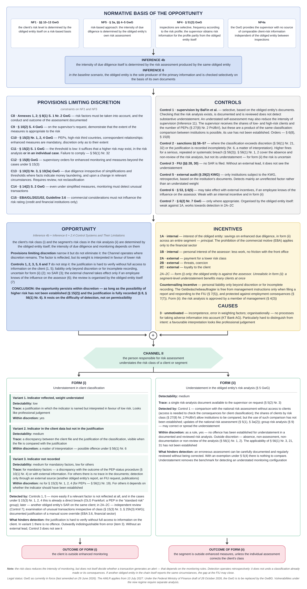

# Channel II — Understated Risk Classification (Client and Obliged-Entity Level)

**Law:** Geldwäschegesetz (GwG)  
**Jurisdiction:** Germany  
**Law version:** as of 29.06.2026  
**Method:** Law-X-Ray Corruption Vulnerability Framework v3.9  
**Level:** Channel of Realisation  

---

> **Limitation on the Subject Matter of the Research**
>
> This work does not offer a comprehensive assessment of the GwG. It does not evaluate the statute's overall effectiveness, the quality of its legislative drafting, its consistency with international standards (FATF, EU law), or any other regulatory criteria. The subject of the research is confined to a single, specific cross-section: the reconstruction of reproducible architectural conditions under which the statute's normative structure creates the possibility of corrupt influence, concealment of information, distortion of decisions, or evasion of oversight. All other aspects of the statute fall outside the scope of the analysis and receive neither a positive nor a negative assessment.
>
> Furthermore, this research does not guarantee an exhaustive reconstruction of every institutional vulnerability that may arise within the GwG normative architecture. The vulnerabilities identified are the result of the analysis performed and do not exclude the existence of other architectural vulnerabilities or institutional configurations that further research may reveal.

---

# Introduction

## What Law-X-Ray Is

Law-X-Ray is a methodology for reconstructing institutional vulnerabilities that arise from the very architecture of a normative act: from which decisions the statute leaves to the discretion of those it addresses, and from how control over those decisions is organised. The reconstruction is built solely on normative facts (provisions of the statute), logical inferences from them and recognised theories, and is then compared against available empirical data.

## What This Document Presents

The document contains the results of a pilot application of the methodology to the German Money Laundering Act (Geldwäschegesetz, GwG): one Channel of Realisation of a vulnerability, selected for initial independent expert review:

- Channel II — understated risk classification (client and obliged-entity level).

The Channel forms part of a broader reconstruction of the GwG. Channel I is set out in a separate document; the other results of the reconstruction are not included in this document. The document has been prepared for review by an anti-money-laundering specialist.

## Structure of the Document

**Section 1** describes the Channel itself: its diagram (1.1) and its description field by field (1.2). The full-size diagram is also available as a separate file: [`channel_02-diagram.pdf`](channel_02-diagram.pdf).

**Section 2** sets out the grounds of the reconstruction: the normative facts, the logical inferences from them, the theoretical basis and the existing control systems with their limitations.

**Section 3** contains the empirical verification.

Normative facts and inferences are numbered consecutively across the full research, so some numbers are skipped in this document.

## How the Channel Description Is Organised

A Channel of Realisation is a concrete, behaviourally describable way in which a structural opportunity created by the statute may be exploited. A Channel is defined by the action, not by its cause. The description of each Channel comprises the following fields:

- **Structural basis** — the normative facts and inferences on which the Channel rests;

- **Description and type of actor** — the action, the forms in which it manifests itself, and who carries it out;

- **Cause / incentive** — what lies behind the action: motivated causes (internal incentives 1A–1B and external incentives 2A–2C) and unmotivated causes (3 — incompetence, error, overload);

- **Rationality** — the ratio of benefit to expected costs for the participants; no quantitative calibration is performed in this document, and parameters that would require it are marked "\[not calibrated\]";

- **Detectability** — whether the action leaves a trace, and who can detect it and under what conditions; the assessments are qualitative;

- **Persistence** — whether the Channel recurs after the first instance and what ends it;

- **Operational details** — whether a more specific operational scheme exists; if so, it is deliberately not described, so that the text does not become an instruction for evading the statute;

- **Empirics** — comparison with decisions of supervisory authorities and case law, stating the access method and the date of verification; set out separately (3. Empirics).

## What the Reviewer Is Asked to Assess

For the Channel, an assessment along five lines would be particularly valuable:

- **Legal accuracy** — whether the relevant provisions of the GwG have been interpreted correctly;

- **Institutional realism** — whether the described scope for discretion actually exists in the German AML system;

- **Practical plausibility** — whether the described conduct is realistic given how compliance is organised in practice;

- **Constraints and controls** — whether the provisions, supervision and other factors that narrow this opportunity have been sufficiently taken into account;

- **Evidentiary sufficiency** — whether the material presented is sufficient for the stated conclusions, and where there are logical or evidentiary gaps.

It is also useful to distinguish between scenarios that are: legally impossible; legally possible but practically unlikely; practically realistic but not yet sufficiently confirmed; already confirmed empirically.

## Legal Status

Provisions are cited according to the GwG as currently in force (last amended on 29 June 2026). Regulation (EU) 2024/1624 (AMLR) applies from 10 July 2027. Under the Federal Ministry of Finance draft of 28 October 2026, the GwG is to be repealed as of that date and replaced by the Geldwäschebekämpfungsgesetz (GwBG). Vulnerabilities under the new regime require separate analysis.

# 1. Channel II — Understated Risk Classification (Client and Obliged-Entity Level)

## 1.1 Channel Diagram

The labels on the diagram (normative facts, constraints C8–C15, inferences, theories and Controls 1–7) are explained in 2. Grounds of the Reconstruction. Full-size diagram: [`channel_02-diagram.pdf`](channel_02-diagram.pdf).

## 1.2 Channel Description

- **Structural basis:**

> – Inference 6 (Normative Facts 1, 2, 4, 4a);
>
> – Normative Fact 1 (§§ 10–13 GwG);
>
> – Normative Fact 5 (§ 3a, §§ 4–5 GwG, subject to constraints C8–C15);
>
> – Inference 4b;
>
> – TB3 — Rational Choice Theory.

- **Description:** The Channel takes two forms: (i) understatement in the classification of a specific client; (ii) understatement in the obliged entity's own risk analysis under § 5 GwG. Form (i): the assessor names a risk indicator in the assessment — for example, a transaction volume atypical for the client's profile — but treats it as explained by the particular features of the client's business and assigns a lower class. Whether the statute requires such indicators to be mentioned individually is a matter of interpretation. However, the assessment must take into account the risk factors listed in Annexes 1 and 2 to the GwG, its conduct and results must be documented (§ 8(1) S. 1 Nr. 2 GwG), and, at the supervisory authority's request, the obliged entity must demonstrate that the extent of the measures taken is appropriate to the risk (§ 10(2) GwG). The Channel operates only where discretion remains. In the cases the statute designates as higher-risk (§ 15(3) Nr. 1, 2 and 4 GwG: politically exposed persons, their family members and close associates; high-risk third countries, except branches and majority-owned subsidiaries of obliged entities established in the EU that fully comply with group-wide policies; cross-border correspondent relationships of obliged entities under § 2(1) Nr. 1–3 and 6–8 GwG with respondents in third countries — and with respondents in the EEA only where the obliged entity itself assesses the risk as higher), the statute requires enhanced measures (§ 15(4)–(7) GwG), and a lower classification would amount to non-fulfilment of those obligations; discretion remains only in determining the specific extent of the enhanced measures. For correspondent relationships with respondents in the EEA, discretion remains at the classification stage itself. For transactions that, compared with similar cases, are particularly complex or unusually large, follow an unusual pattern, or have no apparent economic or lawful purpose (§ 15(3) Nr. 3 GwG), discretion remains at the stage of assessing whether a transaction falls into this category; once it does, the statute requires the transaction to be examined and the relationship to be subjected to enhanced ongoing monitoring (§ 15(6) GwG). Form (i) occurs in three variants. Variant 1: the indicator is reflected in the assessment, but its weight is interpreted in favour of lower risk. This is the area of discretion. Variant 2: the indicator is present in the information on the client or the transactions, but is not reflected in the justification of the classification. This may constitute the offence of incomplete recording (§ 8(1) S. 1 Nr. 2, § 56(1) Nr. 6 GwG) — a matter of interpretation. Variant 3: the indicator is not recorded at all. Where the statute requires enhanced measures for it (§ 15(3) Nr. 1, 2 and 4 GwG), the action goes beyond discretion. Enhanced measures are mandatory as soon as the obliged entity establishes in an individual case that a higher risk may exist (§ 15(2) S. 1 GwG; failure to comply — § 56(1) Nr. 32 GwG). This threshold also applies to the classification of an individual client. At the same time, a single factor from Annex 2 does not in itself mean higher risk: what decides is the overall assessment of all risk-increasing and risk-reducing factors in the specific case (BaFin AuA, Section 2.2.2.1; EBA Guidelines). The exceptions are the cases under § 15(3) and § 15(8) GwG and the situations that the obliged entity has itself identified as higher-risk in its risk analysis: these are mandatory and are not offset by low-risk factors. BRAK guidance for lawyers adds that the possibility of higher risk is assessed by an objective and reasonable standard, and that the more factors there are, the more compelling the conclusion that it exists. Variant 1 is therefore lawful, but limited by this framework. The general due diligence obligations apply irrespective of exceptions, exemptions and thresholds where there are facts indicating money laundering or terrorist financing (§ 10(3) Nr. 3 GwG). In existing relationships, due diligence is repeated, in particular when the client's relevant circumstances change (§ 10(3a) Nr. 1 GwG). These provisions require due diligence to be carried out, but do not require the client to be reclassified automatically. As a result of the understatement, the client remains in a category that does not require the enhanced ongoing monitoring prescribed for higher risk. This reduces the intensity of monitoring but does not by itself determine whether a particular transaction will generate an alert; that also depends on the transaction-monitoring rules. An unusual transaction within the meaning of § 15(3) Nr. 3 GwG must be examined irrespective of the client's class (§ 15(6) GwG; for institutions, § 25h(3) KWG). Since the basis for comparison is partly set by the client's profile, a leniently drawn profile may reduce the sensitivity of this examination. The description of form (i) presupposes that the relevant information is available to the person conducting the assessment. Where it was not available to them, the motivated form of Channel II is not realised: the cause may lie in an unmotivated error or in a prior failure to collect or pass on information, which requires separate characterisation. Form (ii): the obliged entity must identify and assess the money-laundering and terrorist-financing risks associated with its business, taking into account, in particular, the risk factors in Annexes 1 and 2 and the information provided on the basis of the national risk assessment; it must document the risk analysis, review it regularly, update it where necessary and make the current version available to the supervisory authority on request (§ 5(1), (2) GwG). In form (ii), a product, a client segment or a category of transactions is assessed as low-risk contrary to these factors. The national risk assessment is updated regularly, and obliged entities receive its results (§ 3a(2) GwG). An update provides an external trigger for reviewing the risk analysis, but the review is carried out by the obliged entity itself. Within a group, the parent company conducts a risk analysis for the entire group and introduces uniform measures (§ 5(3), § 9(1) GwG). A group methodology may either correct an understatement at a subsidiary or spread it. Since situations that the obliged entity has itself identified as higher-risk in its risk analysis are binding for client classification, the risk analysis also sets the framework of lawful discretion in form (i): understatement in form (ii) widens the scope for variant 1. A segment-level assessment may lawfully determine the approach at client level — simplified measures are permitted where, taking risk factors into account, only a low risk has been established for certain areas, including clients, products or transactions (§ 14(1) GwG) — but it does not replace verification that the specific relationship or transaction actually presents a low risk, and even under simplified measures monitoring must remain capable of detecting unusual or suspicious transactions (§ 14(2) S. 2 GwG; § 56(1) Nr. 31 GwG). Enhanced measures are required where the obliged entity establishes, in its risk analysis or in an individual case, that a higher risk may exist (§ 15(2) S. 1 GwG); the threshold is thus low, and the cases under § 15(3) GwG apply irrespective of the segment rating. Since § 15(2) GwG also links enhanced measures to the risk analysis, an understated risk analysis removes this trigger for the segment concerned \[inference under Rational Choice Theory\]; given the low threshold, such understatement is difficult to justify. Form (ii) is realised only where the segment-level assessment actually prevails over client-specific warning signs; where the individual assessment does correct the classification, the transition is interrupted. Three levels must be distinguished: the persistence of the methodology itself, its application to a specific client, and its effect on the configuration of monitoring. An individual correction interrupts the spread of the understated assessment to a specific client, but does not remove the flaw in the methodology or its effect on monitoring. Since the risk analysis sets the framework both for client classification and for the configuration of monitoring, pressure may shift to the configuration of monitoring or to the escalation decision (Channel I) where its influence on classification is limited.

- **Type of actor:** the person responsible for the risk-assessment process in the organisation — both in designing and applying the assessment methodology and in classifying a specific client. In form (ii): the member of senior management responsible for approving the risk analysis and internal safeguards (cf. § 4(3) GwG), and those who prepare the risk analysis

- **Cause / incentive:** a distinction is drawn between motivated causes (incentives) — internal and external — and unmotivated causes.

> **1. Internal incentives** — created by the obliged entity itself; the obliged entity gains or does not object.
>
> **1A. Interest of the obliged entity** — savings on enhanced due diligence, in form (ii) across an entire segment \[not calibrated\]. The principal incentive of the Channel. Beneficiaries: the obliged entity and the client. Liability arises only where the classification exceeds the bounds of discretion (§ 56(1) Nr. 21, 32 GwG) or where the justification is recorded incompletely (§ 56(1) Nr. 6 GwG, a matter of interpretation); for form (ii) the legal risk is uncertain. For credit and financial institutions, the commercial motive is expressly excluded by the EBA Guidelines (Guideline 3.6). There is no such express prohibition for the DNFBP sector.
>
> **1B. Personal interest of the assessor** — avoiding additional work and friction with the front office. Beneficiaries: the assessor and the obliged entity. Liability — as in item 1A \[not calibrated\].
>
> **2. External incentives** — originate from the client or a third party; the obliged entity is opposed, and its own controls work against the assessor.
>
> **2A. Payment or other benefit** — possible only in form (i): the client pays for a lower risk class. In form (ii) it is unrealistic: a segment-level understatement benefits many clients at once. The value to the client is lower than in Channel I: the risk class reduces the intensity of monitoring but does not rule out an alert. Where the classification remains within discretion, there may be no breach of the GwG, whereas the criminal-law layer (§ 261, § 266 StGB) depends on whether the elements of the offence are satisfied \[not calibrated\].
>
> **2B. Threats or coercion** — only in form (i) \[not calibrated\].
>
> **2C. Loyalty to the client** — only in form (i): the assessor assigns a client close to them a risk class lower than the actual one. Where the classification remains within discretion, there may be no breach of the GwG at all, and such a cause is practically undetectable \[not calibrated\].
>
> **3. Unmotivated causes**
>
> **3. Incompetence, error** — a wrong assessment of the weight of risk factors. In this Channel it is particularly hard to distinguish from intent: the Channel operates within discretion, and a favourable interpretation outwardly looks like professional judgement. The organisational form is the absence of processes for taking adverse information into account (KT Bank AG).
>
> The type of cause changes neither the opportunity nor the action. Unlike in Channel I, it may change the legal characterisation: with an external incentive within discretion there may be no breach of the GwG, whereas criminal liability is possible.

- **Rationality:** the legal risk of the Channel in form (i) differs by variant (see "Description"): in variant 1 it is low — there is no liability as long as the classification remains within discretion; in variant 2 it is uncertain (§ 56(1) Nr. 6 GwG, a matter of interpretation); in variant 3, for factors requiring enhanced measures, it is high. However, the boundary of permissible discretion is subject to subsequent supervisory review, the obliged entity must demonstrate to the supervisory authority on request that the measures are appropriate to the risk (§ 10(2) S. 4 GwG; failure to do so — § 56(1) Nr. 22 GwG), while in proceedings for a fine the burden of proving a breach remains with the authority; a classification found to exceed the boundary of discretion entails administrative liability (§ 56(1) Nr. 21, 32 GwG). Under a general rational-choice logic, the effort and monitoring cost of a stricter classification are judged, on a qualitative basis, to exceed any benefit from it, since the favourable interpretation, as a rule, remains within discretion. For form (ii), the offences relating to § 5 GwG expressly cover failure to identify or assess risks (§ 56(1) Nr. 1 GwG) and failure to document or regularly review the risk analysis (§ 56(1) Nr. 2 GwG), but not understatement in a risk analysis that has been documented and reviewed. Whether such understatement may constitute a breach through other offences — inadequate internal safeguards (§ 6(1), § 56(1) Nr. 3 GwG), failure to determine the extent of due diligence according to risk (§ 10(2) S. 1, § 56(1) Nr. 21 GwG), or insufficient monitoring under simplified measures (§ 56(1) Nr. 31 GwG) — has not been established; the legal risk of form (ii) is therefore described as uncertain rather than absent. The EBA ML/TF Risk Factors Guidelines (EBA/GL/2021/02), addressed to credit and financial institutions, which must make every effort to comply with them, require that economic or profit considerations do not influence the risk rating, that weighting does not make it impossible for any business relationship to be classified as high risk, and that situations which by law always present a high risk are not overruled by the firm's weighting (Guideline 3.6); the same applies mutatis mutandis to the business-wide risk assessment (para. 6), and simplified measures must not be applied where there are indications that the risk may not be low (Guideline 4.44). The commercial motive described in this Channel is thus expressly excluded by the Guidelines; the Channel's persistence rests on the difficulty of detecting such influence, not on its permissibility. Beneficiaries: the obliged entity saves the cost of enhanced due diligence — in form (ii), across an entire segment; the assessor avoids additional work and friction with the front office; the client faces fewer questions and less intensive monitoring. No quantitative calibration was performed \[not calibrated\].

- **Detectability:** differs by form and by variant of form (i) (see "Description"). The assessments are qualitative (see Introduction, "How the Channel Description Is Organised").

- **Form (i), variant 1 — low detectability.** On inspection, the obliged entity presents a documented justification for the classification, which is difficult to verify without full access to information about the client. Under the methodology's criteria: a documentary trail exists but looks like a proper decision — a documented justification of the classification (§ 8(1) S. 1 Nr. 2 GwG). Detection requires access to internal records and to full information about the client. As long as the classification remains within discretion, the action falls within it.

- **Form (i), variant 2 — medium detectability.** The indicator is present in the client information but absent from the justification. This discrepancy is visible when the client file is compared with the justification, although it does not make the breach easy to prove.

- **Form (i), variant 3 — medium detectability for factors requiring enhanced measures, low for others.** PEP status is established using risk-appropriate procedures (§ 10(1) Nr. 4 GwG), and failure to establish it properly is a separate offence (§ 56(1) Nr. 19 GwG). The absence of a record of any other indicator is not visible without an external source. Where a factor for which the statute requires enhanced measures has not been recorded (§ 15(3) Nr. 1, 2 and 4 GwG, subject to the qualification on respondents from the EEA), the action goes beyond discretion. For such factors, variants 2 and 3 are therefore easier to detect than variant 1.

- **Form (ii) — medium detectability.** Under the methodology's criteria: a documentary trail exists and is concentrated in a single document available to the supervisor on request. Comparing the risk analysis with the national risk assessment requires no access to client records, but checking how the understatement has affected client classification and monitoring does require it. The action as a rule falls within discretion, since no offence has been established for understatement in a documented risk analysis (Control 2). The "medium" rating reflects the accessibility of the trail, not how easy it is to prove a breach. The risk analysis is concentrated in a single document available to the supervisory authority on request (§ 5(2) Nr. 3 GwG) and can be compared with the national risk assessment without access to clients. For institutions subject to the KWG, the supervisor also receives quantitative data from the same risk analysis: the auditor's report states the number of clients, the share of low-risk clients, the share of high-risk clients and the number of PEPs (§ 27(8) Nr. 2 PrüfbV; similar data appear in auditors' reports for payment institutions, investment firms and insurers). For credit institutions with total assets of no more than EUR 400 million, this audit is carried out every two years, unless the risk requires it more often (§ 26(4) PrüfbV). These data make it possible to compare institutions with one another, but they are a product of the same classification that is being reviewed, and whether the supervisor applies such a comparison has not been established \[interpretation\]. The detectability rating of form (ii) therefore does not change. However, a review of whether the analysis exists, is documented and is reviewed does not detect substantive understatement: an erroneous assessment can be carefully documented and regularly reviewed without being corrected (cf. the limitation of Control 1). Where the supervisory authority has exempted the obliged entity from documenting the risk analysis (§ 5(4) GwG), there is nothing to compare. Understatement in form (ii) also removes the benchmark against which an understated monitoring configuration is detected. Moreover, since the risk information for the supervisory profile is partly taken from the obliged entity's self-assessment, understatement in form (ii) may also reduce the intensity of supervision of that entity, and with it the probability of detection across all Channels (Inference 11).

- **Common to all forms.** For institutions subject to § 29(2) KWG, Control 5 applies. However, it relies on the institution's own documentation, operates retrospectively and does not undo a classification already made or its consequences. Within the obliged entity, the classification may be reviewed by the independent review of principles and procedures (§ 6(2) Nr. 7 GwG; Control 7). It is mandatory only where appropriate given the nature and scale of the business, and whether it has been carried out falls within the scope of the auditor's review (Annex 5 to the PrüfbV, item 6). Since it is part of the obliged entity itself, such a review is weak against item 1A of "Cause / incentive". In items 2A–2C, where the obliged entity acts against the assessor, it works towards detection \[inference under Rational Choice Theory\]. For credit and financial institutions, it must be possible to override an automatically assigned score manually, and the justification is documented (EBA Guidelines, Guideline 3.6), so a manual downgrade leaves a trace. The internal (§ 6(5) GwG) and external (§ 53 GwG) channels for reporting breaches may increase the probability of detection, especially in items 2A–2C, where an employee knows of external influence on the assessor. In item 1A and in form (ii), understatement is usually not perceived as a breach that could be reported. Records are retained for five years and destroyed no later than after ten (§ 8(4) GwG). Within this window, subsequent review is possible. Since no SAR (suspicious activity report; Verdachtsmeldung under § 43 GwG) is filed, the tipping-off prohibition plays no role in the detectability of this Channel. One obliged entity's classification does not bind others: where another obliged entity in the same chain independently identifies and reports the same circumstances, the information gap at the FIU may be partly or fully closed. The mere presence of another entity does not guarantee this. Such a report gives the FIU information on the client, but does not reveal that the first entity understated the risk class.

- **Persistence: high.** The classification remains in effect until reviewed and does not require a new decision for each transaction. In form (ii), it automatically extends to every new client in the segment unless the individual assessment corrects the classification (see "Description").

> Persistence presupposes that subsequent material information about the client does not trigger a reclassification, although the statute requires this (§ 10(1) Nr. 5 GwG; failure to comply — § 56(1) Nr. 20 GwG). The reason why this trigger may fail is architectural: the decision as to whether new information is material and requires reclassification is taken by the same obliged entity that made the original classification (Normative Fact 1, Inference 6).
>
> The statute provides several external sources of information and triggers for reviewing the original classification:
>
> – requests from the FIU and other authorities as to whether a business relationship existed with specified persons within the past five years (§ 6(6) GwG);
>
> – FIU requests for information, including where no report has been received (§ 30(3) GwG);
>
> – supervisory orders (§ 15(8) GwG);
>
> – updates of the national risk assessment (for form (ii));
>
> – for obliged entities under § 2(1) Nr. 1–9 GwG, the permitted but not mandatory exchange of information among them (§ 47(5) GwG);
>
> – the narrow channels set out in Normative Fact 4a (§ 24c KWG, reports under § 53 GwG).
>
> These sources differ in nature and do not guarantee a review of the class: the decision to make a correction in a specific case is taken by the obliged entity. A suspicious activity report is itself a trigger for review: after it, the client's risk class is, as a rule, raised and enhanced due diligence obligations apply (BaFin AuA, General Part, Nr. 10.11). Non-filing (Channel I; see the report on Channel I) therefore also removes this trigger and thereby increases the persistence of Channel II.
>
> Under risk-based periodicity (§ 10(1) Nr. 5 GwG), a lower risk assessment may lead to less frequent scheduled updating of data. Supervisory guidance sets maximum intervals for such updating. Repeat due diligence upon a change in relevant circumstances (§ 10(3a) GwG) does not depend on this periodicity. In form (ii), the risk analysis may be reviewed regularly while remaining uncorrected, so a formal review does not interrupt the Channel. The Channel ends upon reclassification (including after orders under § 6(8), § 15(8) GwG; for institutions, § 25h(5) KWG) or upon termination of the client relationship. A change of assessor does not end form (ii), which is built into the methodology.

- **Operational details:** not required — the Channel consists in the use of lawful discretion when completing the risk profile, not in covert evasion of the statute; there is no further technical detail here that would need to be withheld.

# 2. Grounds of the Reconstruction

## 2.1 Normative Facts

- **Normative Fact 1** — §§ 10–13 GwG: the obliged entity conducts customer due diligence itself and itself determines the risk level of the client relationship on the basis of a risk-based approach. The initial risk assessment is placed on the obliged entity.

- **Normative Fact 2** — § 43(1) GwG obliges the obliged entity to report once facts indicating suspicion exist; the entity's discretion lies in determining whether such facts exist, not in whether to report once they do. Official interpretive guidance narrows but does not eliminate this discretion (BMF-Auslegungshinweise, 6 November 2014; BaFin/FIU Orientierungshilfe, 28 November 2025). The grounds for concluding that no such facts exist must be recorded (§ 8(1) S. 1 Nr. 5 GwG). The money laundering reporting officer (Geldwäschebeauftragter) is not subject to instructions from management when intending to file a report under § 43(1) GwG or when responding to an FIU request (§ 7(5) S. 6 GwG). This protection is tied to the intention to file a report and applies only where the Geldwäschebeauftragter has been appointed by law or by order (§ 7(1), (3) GwG). In addition, the FIU, in agreement with the supervisory authorities, may specify typified transactions that must always be reported, and transactions to which the reporting obligation does not apply (§ 43(5) S. 1 and 2 GwG). For the former there is no discretion, and non-filing becomes a breach visible without an assessment on the merits; for the latter, non-filing is lawful. Typologies do not remove the problem of discretion. As far as could be established, no general "always report" typologies have been specified for the financial sector. Negative typologies (FIU Eckpunktepapier, agreed with BaFin) apply only "as a rule": where additional information indicates suspicion, a report must be filed, so the question again comes down to the entity's own assessment. At the same time, a reference to a typology gives non-filing a formally lawful justification that is harder to rebut than the absence of any justification. For lawyers and notaries in real-estate transactions, the regulation issued under § 43(6) GwG (GwGMeldV-Immobilien) specifies circumstances that must be reported irrespective of § 43(2) S. 1 GwG. § 7 of the regulation removes this obligation where the available facts dispel the suspicion, and thereby returns the assessment to the entity itself. These provisions are addressed to the obliged entity itself; they narrow but do not eliminate its discretion (see Inference 10 in the report on Channel I). Reference labels: C1 — § 8(1) S. 1 Nr. 5 GwG; C2 — § 7(5) S. 6 GwG; C3 — interpretive guidance (BMF-Auslegungshinweise 2014; BaFin/FIU Orientierungshilfe 2025; BaFin AuA, General Part, Nr. 10.3); C4 — judicial interpretation of the requirement to act without undue delay (OLG Frankfurt a. M., 2 Ss-OWi 1059/17; see the report on Channel I, 1.2 Channel Description, form (iii)); C5 — typologies that must always be reported (§ 43(5) S. 1 GwG); C6 — typologies to which the reporting obligation does not apply (§ 43(5) S. 2 GwG); C7 — circumstances in real-estate transactions that lawyers and notaries are required to report (§ 43(6) GwG, GwGMeldV-Immobilien, including § 7 of the regulation).

- **Normative Fact 3** — § 47 GwG (tipping-off): the obliged entity is prohibited from disclosing the fact that a SAR has been filed to the client, to the party ordering the transaction, or to third parties (§ 47(1) GwG). The prohibition does not extend to the exchange of information among obliged entities themselves: § 47(2) Nr. 2 GwG expressly permits exchange within a single corporate group (only for obliged entities under § 2(1) Nr. 1–3 and 6–8 GwG); § 47(2) Nr. 3 GwG separately permits exchange between a parent company and its branches and group entities in third countries, conditional on those entities having implemented the group-wide measures under § 9(1) GwG. § 47(5) GwG permits obliged entities under § 2(1) Nr. 1–9 GwG to exchange information about suspicious circumstances where another entity needs it to assess the risk of a similar transaction or to decide whether to file a SAR.

- **Normative Fact 4** — §§ 50–52 GwG: supervisory authorities conduct inspections of obliged entities at their discretion, including without specific cause. The frequency and intensity of inspections are determined by the obliged entity's risk profile (§ 51(3) GwG; for institutions subject to the KWG, inspections without specific cause are provided for by § 44(1) S. 2 KWG). The statute does not provide for blanket review of every decision of the obliged entity. The supervisor obtains information on the obliged entity's risks partly from the entity itself: for institutions subject to the KWG — in the auditor's reporting form, where risk factors are stated on the basis of the institution's own risk analysis (§ 27(8) PrüfbV); for entities supervised by professional chambers — through questionnaires that obliged entities must complete under § 52(1) GwG. External sources are also taken into account — the results of previous inspections and reports under § 53 GwG.

- **Normative Fact 4a** — the GwG does not provide the supervisory authority, in the intervals between inspections, with a source of comparable client-risk information independent of the obliged entity. A narrow independent channel exists for credit institutions via the account-retrieval procedure under § 24c KWG (Kontenabrufverfahren): BaFin and the Bundeszentralamt für Steuern (Federal Central Tax Office) may retrieve account master data (account number, holder's name and date of birth) directly from all German credit institutions, independent of what the obliged entity itself discloses. This channel does not cover account balances, transactions or risk classification, and is used by BaFin/BZSt principally on a case-by-case basis (e.g., a suspected offence) rather than for routine ongoing AML monitoring between inspections. No equivalent channel is available for the DNFBP sector — lawyers and notaries are not entitled parties under § 24c(3) KWG. The claim in this Normative Fact accordingly retains full force for the DNFBP sector, and is narrowed, but not eliminated, for credit institutions. In addition, any person, including an employee of the obliged entity, may report a potential or actual breach of the GwG directly to the supervisory authority (§ 53 GwG; Control 6). This source does not depend on the obliged entity's documentation, but whether it arises depends on the initiative of third parties, and it does not provide comparable client-risk information. It therefore narrows, but does not eliminate, the claim in this Normative Fact. Note on method: this is a negative normative fact — it is established from the text of the statute through the absence of a corresponding provision, not from a specific provision.

- **Normative Fact 5** — § 3a GwG establishes the risk-based approach as the statute's core architectural principle; §§ 4–5 GwG implement it at the level of the obliged entity's operational obligations. The intensity of due diligence is determined by the risk assessment that the obliged entity itself produces. Constraints on Normative Facts 1 and 5 (reference labels): C8 — Annexes 1, 2 to the GwG; § 8(1) S. 1 Nr. 2 GwG (risk factors must be taken into account, and the conduct and outcome of the assessment documented); C9 — § 10(2) S. 4 GwG (on the supervisor's request, demonstrate that the extent of the measures is appropriate to the risk); C10 — § 15(3) Nr. 1, 2, 4 GwG (PEPs, high-risk third countries, correspondent relationships: enhanced measures are mandatory, discretion only as to their extent); C11 — § 15(2) S. 1 GwG (it suffices that a higher risk may exist, in the risk analysis or in an individual case); C12 — § 15(8) GwG (supervisory orders for enhanced monitoring and measures beyond the cases under § 15(3)); C13 — § 10(3) Nr. 3, § 10(3a) GwG (due diligence irrespective of simplifications and thresholds where facts indicate money laundering, and upon a change in relevant circumstances; requires review, not reclassification); C14 — § 14(2) S. 2 GwG (even under simplified measures, monitoring must detect unusual transactions); C15 — EBA/GL/2021/02, Guideline 3.6 (commercial considerations must not influence the risk rating; credit and financial institutions only).

**General Caveats**

- Interpretive texts used in this reconstruction are limited to those whose existence follows from the design of the legal framework: BaFin's interpretive guidance issued under § 51(8) GwG; the EBA ML/TF Risk Factors Guidelines issued under Articles 17 and 18(4) of Directive (EU) 2015/849; the FIU's guidance on the GwGMeldV — a regulation issued under § 45(5) GwG — published within the FIU's statutory task of exchange with obliged entities (§ 28(1) GwG); and the FIU typologies specified under § 43(5) GwG. Supervisory decisions, fines and case law are not used as a basis for any conclusion in the reconstruction; they appear only in the empirical verification.

- Legal status: provisions are cited according to the GwG as currently in force (last amended on 29 June 2026). Regulation (EU) 2024/1624 (AMLR) applies from 10 July 2027. Under the Federal Ministry of Finance draft of 28 October 2026, the GwG is to be repealed as of that date and replaced by the Geldwäschebekämpfungsgesetz (GwBG). Vulnerabilities under the new regime require separate analysis.

## 2.2 Logical Inferences from the Normative Facts

- **Inference 1.** From Normative Facts 1+2 it follows \[deduction from the norm\]: primary AML information is produced and interpreted by the obliged entity — the FIU and the supervisory authorities are structurally dependent on the obliged entity's primary information. (A fuller basis for this claim is established below, together with Normative Fact 4a.)

- **Inference 2.** From Normative Fact 3 it follows \[deduction from the norm\]: the prohibition on disclosing that a SAR has been filed structurally isolates the client from knowledge of the escalation. At the same time, the statute does not prohibit — and in fact expressly permits — the exchange of information about suspicious circumstances among obliged entities themselves (§ 47(2), (5) GwG). This is a permission ("dürfen"), not an obligation, and it does not create an institutional mechanism guaranteeing that such exchange actually occurs. The isolation of information among entities is therefore not structurally prohibited by the statute, but nor is it structurally guaranteed by it — it depends on whether obliged entities make use of the opportunity provided, which goes beyond deduction from the norm.

- **Inference 3.** From Normative Fact 4 it follows \[deduction from the norm\]: external verification of the entity's decisions is periodic and selective, not continuous.

- **Inference 4a.** From Normative Facts 1+2+4+4a it follows \[institutional consequence\]: the entity exercises discretionary judgement while holding an informational advantage over the supervisory authority.

- **Inference 4b.** From Normative Fact 5 it follows: the intensity of due diligence itself is likewise determined by the risk assessment that the same obliged entity produces.

- **Inference 6 (combined).** In the baseline scenario (disregarding the countervailing incentive described in the "Caveat on the internal conflict of interest", **TB1**) — a structural asymmetry arises:

  — the obliged entity is the sole producer of the primary information, takes discretionary decisions on its escalation, and is subject to verification only selectively and on the basis of the very information it produced itself (combined: Normative Facts 1, 2, 4, 4a).

- **Inference 11.** From Normative Fact 4 (with the caveat on information for the risk profile) and Normative Fact 5 it follows \[institutional consequence\]: the intensity of supervision is partly determined by the entity's self-assessment of risk: the information on the basis of which the supervisor determines the obliged entity's risk profile, and through it the frequency and intensity of inspections (§ 51(3) GwG), is partly taken from the self-assessment of risk produced by the same obliged entity (cf. Inference 4b). The extent to which this information actually determines the supervisory profile does not follow from the text of the statute \[limitation of the inference\]. An understated self-assessment (Channel II, form (ii)) may therefore also reduce the intensity of supervision, and with it the probability of detection across all Channels of that obliged entity.

## 2.3 Theoretical Basis

- **TB1 — Principal-Agent Theory** → explains the conflict of interest between the obliged entity (agent) and the state/FIU (principal): the agent holds an informational advantage and a commercial incentive to use it in its own interest rather than the principal's. Applied to the internal structure of the obliged entity, the same construction applies to employees: their individual incentives may diverge from the obliged entity's duties in both directions (see the Caveat below).

> **Caveat on the internal conflict of interest.** The reconstruction treats the obliged entity as a single actor. In reality, the compliance function within the organisation is performed by a specific natural person (§ 7 GwG — the Geldwäschebeauftragter; see also § 4(3) GwG on responsibility at senior-management level), who bears personal administrative and, in some cases, criminal liability. This creates a potential countervailing incentive — to overstate rather than understate the risk classification — which runs counter to the incentive of the obliged entity as a legal person. The combined effect of these two opposing incentives has not been assessed in this analysis and requires separate consideration. Individual incentives within the obliged entity, however, run in both directions (TB1, applied to the internal structure of the obliged entity). Personal liability creates an incentive for the Geldwäschebeauftragter to overstate risk; remuneration of employees that depends on client business creates an incentive to understate risk and to withhold information. Which of these prevails depends on the organisational configuration and is not assessed in this reconstruction. The incentive based on personal liability is conditional: the offences in § 56 GwG are not made out as long as the classification remains within discretion and the justification is fully recorded, so in variant 1 of form (i) (see the Channel's "Description"), where the Channel is persistent, this incentive does not arise. Other consequences for the employee (employment-related, disciplinary) are not assessed here. The position of the Geldwäschebeauftragter is determined by three different provisions: they are not subject to instructions from management only when intending to file a report or when responding to an FIU request (§ 7(5) S. 6 GwG), and this does not extend to classification decisions; they are protected against disadvantage in the employment relationship for performing their tasks (§ 7(7) GwG); the risk analysis is approved by the designated member of management (§ 4(3) GwG) — the Geldwäschebeauftragter may prepare it, but does not take the decision to approve it. The principal incentive of the Channel operates at the level of the obliged entity's risk-classification methodology. External incentives are considered under "Cause / incentive" of the Channel, item 2. Where the countervailing incentive partly restrains realisation of the Channel in individual cases, it functions as a downward-adjusting factor rather than a refutation of the reconstruction. However, since individual incentives may also reinforce the vulnerability, the Incentive assessed here cannot be read without qualification as a conservative (lower-bound) estimate. Apart from the commercial incentive, there is an incentive of a different kind: where an FIU request under § 30(3) GwG reaches an entity that has filed no SAR, a complete response may reveal the entity's own breach of § 43 GwG. This incentive toward a minimal response is constrained by § 56(1) Nr. 67 GwG and by the independence of the Geldwäschebeauftragter when responding (§ 7(5) GwG). Moreover, responding to an FIU request exempts the entity from liability for the response itself (§ 48(2) Nr. 2 GwG), but not for the earlier non-filing.
>
> Allocation of liability. The offences in § 56 GwG are addressed to the obliged entity. An individual is liable for them where acting as a representative body of the obliged entity, or where expressly instructed to perform, on their own responsibility, duties incumbent on the obliged entity (§ 9(1), (2) OWiG). Any person who participates in an offence is liable as a participant even where the special personal characteristic — being the obliged entity — is present only in another participant (§ 14(1) OWiG). The obliged entity itself may be fined where a person in a leading position commits an offence that violates the obliged entity's duties (§ 30(1) OWiG), and the owner is liable for omitting supervisory measures required to prevent such violations, where proper supervision would have prevented or substantially impeded them (§ 130(1) OWiG). This allocation applies in particular to Channels I and V, including where the incentive is external (item 2A).

- **TB2 — Information Asymmetry Theory** → explains the dependence of the FIU and the supervisory authorities on the information the entity produces.

- **TB3 — Rational Choice Theory** → explains the choice between performing a duty and breaching it by the ratio of expected benefit to expected costs. It underlies the "Rationality" field of the Channel and the inferences marked \[inference under Rational Choice Theory\]. Applied to Channel II: under a general rational-choice logic, the effort and monitoring cost of a stricter risk classification are judged, on a qualitative basis, to exceed any benefit from it, given that the understated classification, as a rule, remains within discretion and carries a low risk of sanction.

- **TB4 — Agency Cost Theory** (Jensen & Meckling 1976) → the outright-refusal Channel (Channel I; see the report on Channel I) requires an active decision not to escalate a detected signal — this creates monitoring and control costs for the compliance function (the risk of being caught in deliberate inaction). The understated-classification Channel (Channel II), by contrast, requires no separate decision to stay silent: the cost is built into the risk-assessment methodology itself and requires no additional monitoring of its execution — making it structurally cheaper in terms of the principal's costs of monitoring the agent.

## 2.4 Control Systems and Their Limitations

- **Control 1 — Periodic Inspections by BaFin and Other Supervisory Authorities** → Control Limitation \[architectural\]: inspections rely predominantly on documentation produced by the entity itself. Across all sectors, oversight is periodic and risk-based rather than continuous. The reconstructed limitation retains full force for the DNFBP sector and is narrowed, but not eliminated, for credit institutions (§ 24c KWG; Normative Fact 4a). Beyond periodic inspections, the supervisory authority may issue orders in individual cases to establish the internal safeguards necessary to comply with the statute (§ 6(8) GwG; for institutions, § 25h(5) KWG). Such orders end further exploitation of the vulnerability; they neither prevent the initial transition nor recover cases already missed. In addition, the supervisory authority may order enhanced monitoring and additional due diligence measures where facts or assessments justify a higher risk beyond the cases under § 15(3) GwG (§ 15(8) GwG). In the cases covered by the order, this limits the obliged entity's discretion, and failure to comply with the order is an offence (§ 56(1) Nr. 45 GwG). Under § 44(1) GwG, a supervisory authority that discovers facts indicating possible money laundering or terrorist financing must report them to the FIU without undue delay (except in the case under § 44(1) S. 2 GwG). Detection of a breach by the supervisor may thus fill the FIU's information gap, although not necessarily before the suspicious transaction is carried out.

- **Control 2 — The Sanctions Regime Under §§ 56–57 GwG** → Control Limitation \[architectural\]: the sanction for failing to file a SAR requires proof of intent or gross negligence. Beyond non-filing, § 56 GwG also covers late filing (§ 56(1) Nr. 69, "nicht rechtzeitig"), delay in filing a report after lawful execution of a transaction (§ 56(1) Nr. 70), execution of a transaction for which a report has been filed before the waiting period has expired (§ 56(2) Nr. 6, including by simple negligence), and failure to comply, or incorrect, incomplete or late compliance, with an FIU request (§ 56(1) Nr. 67). The offences relating to § 5 GwG (§ 56(1) Nr. 1, 2) expressly cover absence, non-documentation and non-review of the risk analysis, but not its understatement; whether other offences apply to understatement remains open. A separate offence is the incorrect or incomplete recording of information, considerations or the justification of the outcome of an assessment (§ 56(1) Nr. 6 in conjunction with § 8(1) GwG), committed with intent or gross negligence. Whether it covers the omission of an individual indicator from the justification depends on whether the indicator had to be recorded, and is a matter of interpretation. For a serious, repeated or systematic breach, the fine limits are raised (§ 56(3) GwG).

- **Control 3 — The FIU as the Central Node for SAR Analysis (§§ 28, 30 GwG; see also § 47 GwG on the tipping-off prohibition and § 49 GwG on protecting the reporting employee's identity)** → Control Limitation \[architectural\]: the FIU depends predominantly on reports from the obliged entities themselves. Other sources of information and independent powers are provided for by § 30(1), (2a), (3), § 44 GwG and § 31b AO. However, detecting a specific case of non-filing of which the FIU is unaware requires an independent external lead.

- **Control 4 — The Transparenzregister (Transparency Register; §§ 18, 20 GwG)** → Control Limitation \[operational\]: the register is based on self-declaration. The control applies to Channel II only indirectly: information on beneficial owners forms part of the data used for classification, but the register does not verify the risk class.

- **Control 5 — Mandatory External Audit of GwG Compliance for Institutions Subject to § 29(2) KWG (§§ 26–27 PrüfbV)** → Control Limitation \[architectural; the control operates only partially\]: applies only to institutions subject to the KWG; the auditor is engaged and paid by the audited institution; the audit is sample-based and relies predominantly on the institution's own documentation. For Channel II, it detects mainly variants 2 and 3 of form (i), and variant 1 only on reviewing the justification on the merits, not on checking that it exists.

- **Control 6 — External Channel for Reporting Breaches to the Supervisory Authority (§ 53 GwG; where the system is operated by BaFin, § 4d FinDAG)** → Control Limitation \[architectural; the control operates only partially\]: supervisory authorities must accept reports of potential or actual breaches of the GwG, including anonymous ones (§ 53(1) GwG). An employee who has filed a report is protected against employment-related, criminal and other adverse consequences, unless the report was knowingly or grossly negligently false (§ 53(5) GwG), and the right to file a report cannot be restricted by contract (§ 53(6) GwG). Where the system is operated by BaFin, it is governed by § 4d FinDAG, and subsections 3–7 of § 53 GwG do not apply (§ 53(8) GwG). This is the only control whose source is persons who know of the breach. A report by another obliged entity on the same client also operates independently of the obliged entity's documentation (see 1.2 Channel Description, "Detectability"). However, the control takes effect only where someone other than the decision-maker knows of the breach and decides to report it. In Channel II, it may take effect in items 2A–2C of "Cause / incentive", where an employee knows of external influence on the assessor. In item 1A and in form (ii), understatement is usually not perceived as a breach that could be reported. Unlike the internal channel (§ 6(5) GwG), it formally also operates where the breach benefits the obliged entity itself.

- **Control 7 — Independent Review of Internal Safeguards (§ 6(2) Nr. 7 GwG); for Credit Institutions, Independent Internal Audit (§ 25a(1) KWG)** → Control Limitation \[architectural; the control operates only partially\]: the review covers the established principles and procedures, not individual decisions, and only where such a review is proportionate to the type and scale of the business. The review is organised by the obliged entity itself. The classification methodology and the procedures for managing risks are among the procedures reviewed (§ 6(2) Nr. 1 GwG), so the control reaches form (ii) to a greater extent than individual classifications under form (i). Against incentive 1A, where understatement benefits the obliged entity itself, the control is weak, while against incentives 2A–2C it operates. It works retrospectively.

**Conclusion:** The limitations of Controls 1–3 are architectural: they follow from the design of the controls themselves and cannot be removed by adding resources. The limitation of Control 4 is operational (the register is based on self-declaration), and it applies to Channel II only indirectly. The limitations of Controls 5, 6 and 7 are also architectural, but these controls operate only partially: Control 5 covers only institutions subject to the KWG and reaches variant 1 of form (i) only on reviewing the justification on the merits; Control 6 takes effect only if someone other than the decision-maker knows of the breach and decides to report it, and in item 1A and in form (ii) understatement is usually not perceived as a breach; Control 7 reviews procedures, not individual classifications, and is organised by the obliged entity itself. Adding resources can increase only the sample size (Control 5) and the frequency of reviews (Control 7), but does not remove these limitations.

# 3. Empirics
**Form (i)**

**BaFin Decisions**

- **KT Bank AG.** BaFin found that "there were no processes in place to ensure that adverse information was taken into account in the client's risk classification". The decision was published on 23 January 2025. This is form (i): adverse information was not taken into account in classifying clients. Whether this is variant 2 or 3 cannot be determined from the publication, since it does not show whether this information was in the client files. The matter concerns a deficiency in processes, not a motivated choice, so the case confirms form (i) as a legal category, but not the incentive. The same fine notice (Bußgeldbescheid) also contains a second, separate breach — failure to file a suspicious activity report (see the report on Channel I, 3. Empirics). This is one case with two breaches, not two independent confirmations.

- **Source.** Web search, not a complete register of decisions, so completeness is not guaranteed. Date verified: 30 July 2026.

**Case Law**

- **Case.** OLG Frankfurt a. M., decision of 10 April 2018, 2 Ss-OWi 1059/17 (for more on the case, see the report on Channel I, 3. Empirics). The client, the spouse of a politically exposed person and therefore a PEP herself, had been placed in the "standard risk" group. PEP status had not been recorded for any of her accounts, and the bank had not introduced a procedure for establishing PEP status.

- **Characterisation.** This is variant 3 of form (i): the indicator was not recorded. Since the statute requires enhanced measures for PEPs, this is a direct breach, not an exercise of discretion.

- **Limitations.** A motivated choice within the meaning of items 1A–2C (see 1.2 Channel Description, "Cause / incentive") was not established by the court. The decision was issued under the former version of the statute.

- **Source.** Official text of the decision (WPK Magazin 2/2019). Date verified: 29 October 2026.

**Form (ii)**

**International Evidence**

- **FSA (United Kingdom).** "Banks’ management of high money-laundering risk situations", June 2011: a thematic review of 27 banking groups. Some banks assigned inappropriately low weightings to certain high-risk factors, apparently — and sometimes overtly — in order to avoid applying enhanced due diligence to much of their business. One bank treated several higher-risk countries as low-risk because it did a great deal of business with them. Sectors with elevated corruption risk were rated low-risk on the grounds that they were "regulated". Some methodologies made it almost impossible for a relationship to be rated high-risk.

- **Limitations.** A different jurisdiction: the evidence confirms the behavioural layer, and no legal conclusions are carried over to the GwG. The data relate to 2010–2011. No search for German evidence on form (ii) was conducted.

- **Source.** Web search, FSA primary source. Date verified: 11 October 2026.

**General Limitation**

- **Limits of the empirics.** The empirics can confirm only cases where discretion was used so extremely that it became a proven breach of § 10 GwG. A successful use of the same Channel that stayed within lawful limits cannot, by its nature, be reflected in enforcement data.
